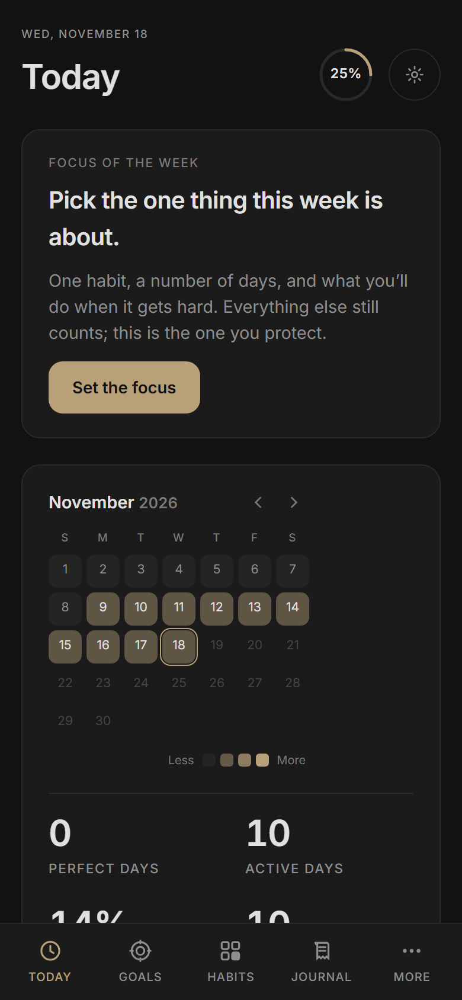

# Upgrade

A personal-development app that keeps habits, goals, journaling, meditation, reading and training in one place, built around a simple loop: **set a goal → pick one focus for the week → log the days → review on Sunday.**

**Live app:** https://safrancop.github.io/upgrade/

No account and no server. Your data stays in your browser, and you can export or import it as a JSON file at any time.


## Features

- **Today.** Daily rituals with one-tap check-offs and undo, a monthly calendar heat map, streaks, a weekly momentum ring, milestones, and a morning and evening check-in for energy, sleep and mood.
- **Goals.** Up to three goals per quarter, each with a reason, a metric that updates itself from logged activity (pages, workouts, minutes, km), an obstacle with an if-then plan (WOOP), and milestones.
- **Habits.** Habits defined like a recipe: target, how many days a week count as success, a minimum version, an anchor ("after I…") and an if-then plan. You can view them as a grid, a week or streaks.
- **Journal.** Writing prompts, gratitude, full-text search, "on this day", mood insights, and a Sunday week review shaped as an after-action review (planned vs. done).
- **Meditation.** Breathwork with three animated patterns, a 27-session guided course, a timer, and seven ambient sound channels generated live with the Web Audio API.
- **Exercise.** Workout logging with a 400-exercise catalog, personal-record detection, weekly volume per muscle group, strength levels compared against reference standards, and cardio goals.
- **Reading, Mind and Lessons.** A book shelf with session logging, identity statements, and daily evidence-based lessons.

| Habits | Journal |
|---|---|
|  |  |
| **Meditation** | **Strength** |
|  |  |

It also works on a phone, with a bottom tab bar:



## How it's built

- **Plain HTML, CSS and JavaScript.** No framework and no build step: `index.html`, `css/styles.css` and `js/app.js`.
- **Local-first storage.** Every change is written to `localStorage` right away, as one document per day plus a profile, habits and books. A backup restore merges by `updatedAt`: the newest copy of each day wins and nothing gets dropped.
- **Audio.** The meditation soundscapes and timer bells are generated with the Web Audio API, so there are no audio files.
- **Accessibility.** Keyboard navigation, `aria` labels on controls, and support for `prefers-reduced-motion`.
- **Data sources.** The exercise catalog comes from [free-exercise-db](https://github.com/yuhonas/free-exercise-db) and is embedded with `scripts/build-exercise-catalog.mjs`.

## Run it locally

```bash
npm install
npm run dev          # http://localhost:4780, reloads when you save
```

You can also just open `index.html` in a browser.

## Tests

```bash
npx playwright install chromium   # first time only
npm test                          # jsdom walkthrough of every view and tab, plus a negative control
npm run test:e2e                  # Chromium at desktop and phone width: navigation, persistence, export/import
```

- `npm test` boots the app with seeded data and walks all 11 sections and 31 tabs. On the way it checks the meditation timer math, PR detection, weekly training volume, strength percentiles, journal search, undo, persistence and backup restore.
- The negative control turns off saving and checks that the suite fails. That proves the persistence checks actually test something.
- CI runs both suites on every push and deploys to GitHub Pages only when they pass.

## Project structure

```
index.html            markup and layout
css/styles.css        styles
js/app.js             the app: state, storage, views
tests/                harness (jsdom) and end-to-end tests (Playwright)
scripts/              dev server, screenshots, data builders
docs/screenshots/     images used in this README
```

## License

MIT
