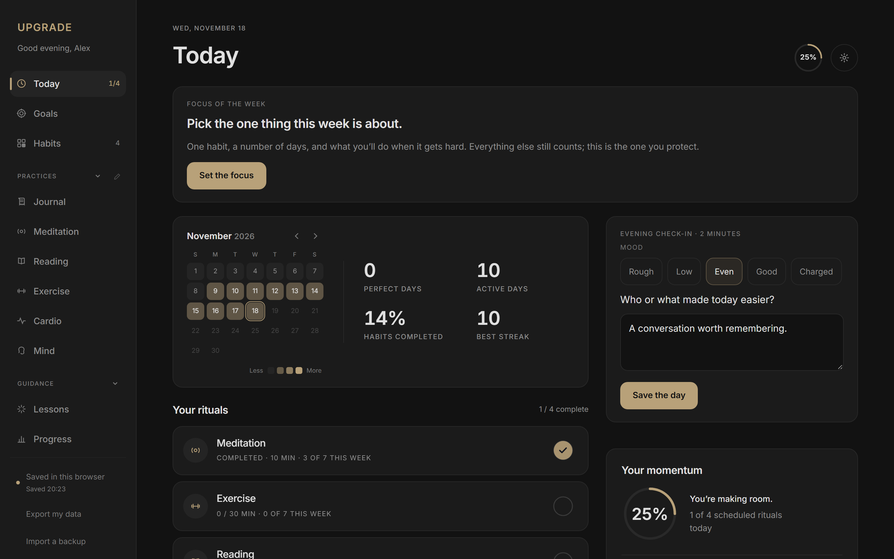
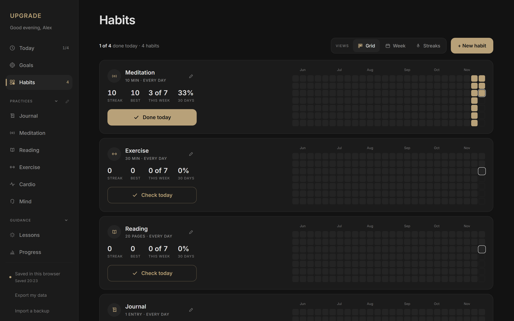
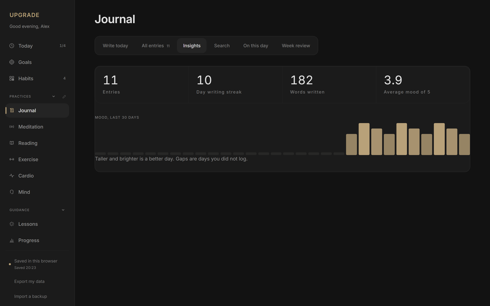
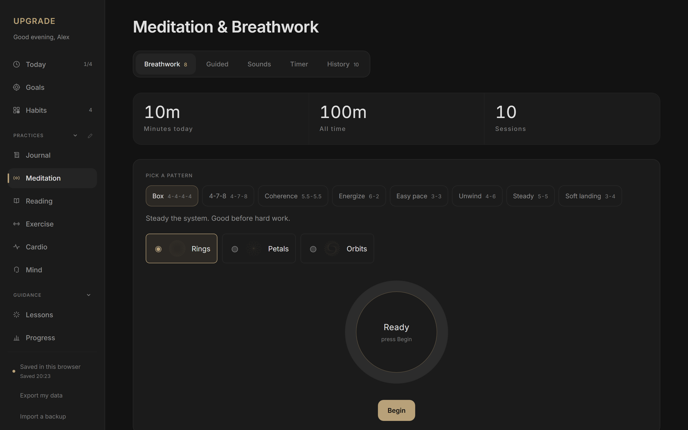
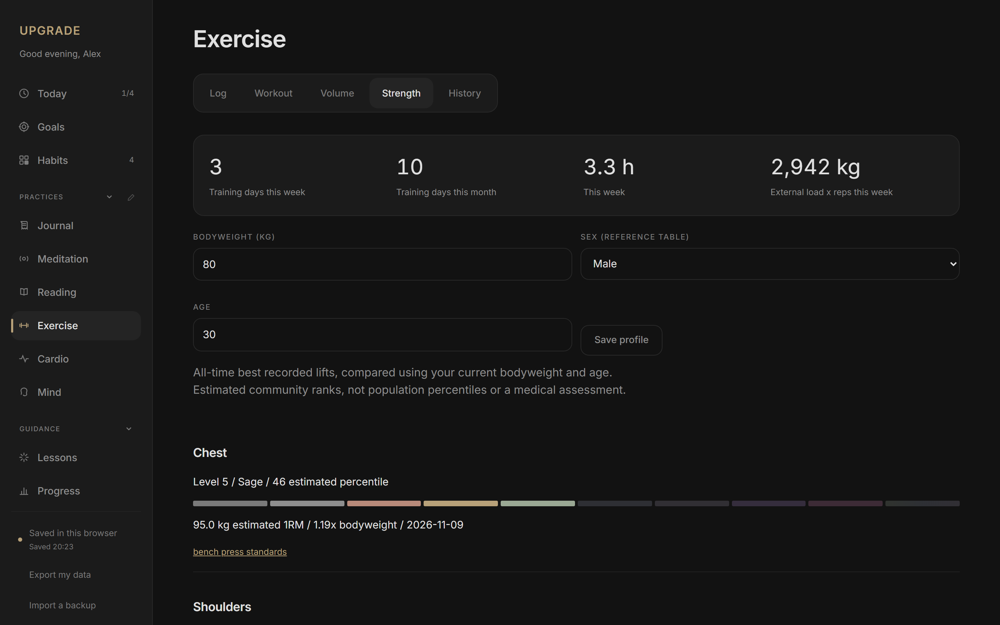

# Upgrade

A personal-development app that keeps habits, goals, journaling, meditation, reading and training in one place, built around a simple weekly loop: **set a goal → pick one focus for the week → log the days → review on Sunday.**

**Live app:** https://safrancop.github.io/upgrade/

No account and no server. Your data stays in your browser, and you can export or import it as a JSON file at any time.



## Why I built it

I wanted one place for the habits, training, reading and reflection I was tracking separately, and I wanted it to push back a little: goals carry a written reason, each week has one focus, and the Sunday review compares what I planned with what actually happened. It is built for my own daily use, and its features come from that.

## Features

- **Today.** Daily rituals with one-tap check-offs and undo, a monthly calendar heat map, streaks, a weekly momentum ring, milestones, and a morning and evening check-in for energy, sleep and mood.
- **Goals.** Up to three goals per quarter, each with a reason, a metric that updates itself from logged activity (pages, workouts, minutes, km), an obstacle with an if-then plan (WOOP), and milestones.
- **Habits.** Habits defined like a recipe: target, how many days a week count as success, a minimum version, an anchor ("after I…") and an if-then plan. You can view them as a grid, a week or streaks.
- **Journal.** Writing prompts, gratitude, full-text search, "on this day", mood insights, and a Sunday week review shaped as an after-action review (planned vs. done).
- **Meditation.** Breathwork with three animated patterns, a 27-session guided course, a timer, and ambient soundscapes generated live with the Web Audio API.
- **Exercise.** Workout logging with a 400-exercise catalog, personal-record detection, weekly volume per muscle group, strength levels compared against published standards, and cardio goals.
- **Reading, Mind and Lessons.** A book shelf with session logging, identity statements, and daily evidence-based lessons.

| Habits | Journal |
|---|---|
|  |  |
| **Meditation** | **Strength** |
|  |  |

It also works on a phone, with a bottom tab bar:


## How it's built

- **Plain HTML, CSS and JavaScript.** No framework and no build step. The files in this repository are the files that get deployed.
- **Local-first.** Every change is written to `localStorage` right away. Export and Import move the data between browsers. Some common ways to lose data are handled explicitly: two open tabs, a browser that refuses to save, a browser that evicts site data, and importing into a new device.
- **Content-Security-Policy.** The page only runs its own scripts and makes no network requests.
- **Tested in a real browser.** Playwright runs the app at desktop and phone width; a jsdom harness covers the domain logic.

The reasoning behind each of these choices, and its trade-offs, is in [docs/ARCHITECTURE.md](docs/ARCHITECTURE.md).

## Run it locally

Requires Node.js 20 or newer.

```bash
npm install
npm run dev          # http://localhost:4780, reloads when you save
```

You can also just open `index.html` in a browser.

## Tests

```bash
npx playwright install chromium   # first time only
npm test                          # jsdom harness: every view and tab, domain logic, persistence, negative control
npm run test:e2e                  # Chromium at 1440 px and 400 px, served over HTTP
APP_URL=https://safrancop.github.io/upgrade/ npm run test:e2e   # same checks against the live site
```

The end-to-end suite checks navigation and layout overflow in every section, persistence across reloads, two-tab safety, export and import (including a malformed file), that stored HTML never renders as markup, and the messages shown when saving fails or a backup is due.

## Project structure

```
index.html            markup, CSP and script order
css/styles.css        styles
js/app.js             state, storage and every view
js/data/              static content and generated datasets
tests/                jsdom harness and Playwright end-to-end tests
scripts/              dev server, screenshots, dataset builders
docs/                 architecture notes and screenshots
```

## Data sources

- Exercise catalog: [free-exercise-db](https://github.com/yuhonas/free-exercise-db), via `scripts/build-exercise-catalog.mjs`.
- Strength reference tables: published standards from strengthlevel.com, via `scripts/build-strength-standards.mjs`. They are estimates for comparison, not medical or population data.

## License

MIT
